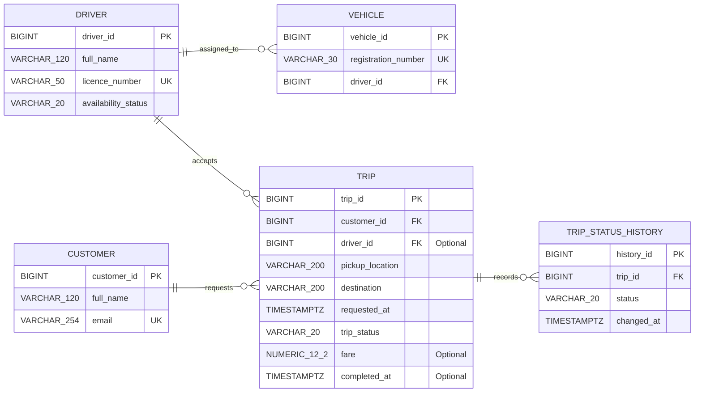

# Ride-hailing System ER Diagram

## Explanation

- **PK (Primary Key):** Uniquely identifies each record in a table.
- **FK (Foreign Key):** Links a record to a record in another table.
- **UK (Unique Key):** Prevents duplicate values in a field, such as customer email or vehicle registration number.
- **Relationship symbols:** `||` means exactly one; `o|` means zero or one; and `o{` means zero or many. For example, a customer can request zero or many trips, while each trip belongs to exactly one customer.

## Example

A customer requests three rides. Each ride has a different `trip_id` and belongs to that customer through `customer_id`. A new trip can have no assigned driver until a driver accepts it.

## Optional Fields and Additional Rules

The `trip.driver_id`, `trip.fare`, and `trip.completed_at` fields are optional when they are not yet applicable. The other fields are required in the agreed design.

The design also requires rules beyond the relationships shown in the diagram. Pickup and destination must differ. A driver must be available before accepting a trip and cannot accept another trip while an assigned trip is in progress. Trip statuses must follow a valid sequence, and completed or cancelled trips cannot be reopened. A fare cannot be negative; a completed trip must have a fare and a completion time later than its request time. These rules need suitable database constraints and/or transaction logic, including protection against concurrent assignment requests.
